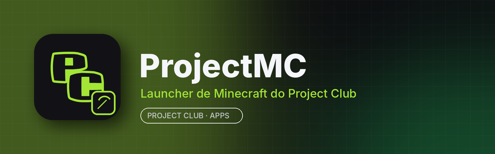

<p align="center"></p>

# ProjectMC

**ProjectMC** é o launcher de Minecraft do **Project Club**: organize instâncias, instale mods, modpacks, resource packs e shaders e entre no jogo com a sua conta, tudo em um só lugar e integrado à aba **Apps** do app para computador.

É baseado no **[X Minecraft Launcher (XMCL)](https://github.com/Voxelum/x-minecraft-launcher)**, de código aberto sob a licença MIT. Todos os recursos do XMCL continuam aqui; o ProjectMC troca o nome, o ícone e os identificadores e faz a integração com o Project Club.

## Principais recursos

- Várias instâncias isoladas, cada uma com sua versão, mods e configurações
- Instala Forge, NeoForge, Fabric, Quilt e OptiFine automaticamente
- Busca e instala mods, modpacks, resource packs e shaders do **Modrinth** e do **CurseForge**
- Importa e exporta modpacks (Modrinth `.mrpack` e CurseForge)
- Login com conta Microsoft e gerenciamento de várias contas e skins
- Gerencia o Java automaticamente (baixa a versão certa para cada versão do jogo)
- Multiplayer entre amigos (P2P) e lista de servidores
- Atualizações automáticas pelo próprio launcher e pela aba Apps do Project Club

## Instalar

Pelo **Project Club** (recomendado): aba **Apps → ProjectMC → Instalar**. As atualizações chegam por lá.

Manual: baixe em [Releases](../../releases):
- **Windows 10/11 (64 bits):** `projectmc-<versão>-win.exe` (portátil) ou o instalador `goldapple-launcher-setup-<build>.exe`
- **Linux (x86_64):** `projectmc-<versão>-linux.AppImage` → `chmod +x *.AppImage && ./projectmc-*.AppImage`

## Requisitos

| | Mínimo | Recomendado |
|---|---|---|
| Sistema | Windows 10 64 bits / Linux x86_64 | Windows 11 / Ubuntu 22.04+ |
| CPU | 2 núcleos | 4 núcleos ou mais |
| RAM | 4 GB (o launcher usa ~200–400 MB; o jogo usa o que você reservar) | 8–16 GB para modpacks |
| GPU | OpenGL 3.3 (exigência do Minecraft Java) | GPU dedicada para shaders |
| Disco | ~400 MB para o launcher + espaço das instâncias | SSD |

## Compilar

Node.js 22 e pnpm (veja [docs/README-XMCL-original.md](docs/README-XMCL-original.md) e [LEIA-ME-PROJECTMC.md](LEIA-ME-PROJECTMC.md)):

```bash
git clone https://github.com/RiqueBitt/ProjectMC
cd ProjectMC
pnpm install
pnpm run --prefix xmcl-keystone-ui build
pnpm run --prefix xmcl-electron-app build
```

Workflows:
- **Build Windows EXE (ProjectMC)** — roda a cada push na `main` e publica a build `v<número>` com o instalador e o `latest.yml` usado pela atualização automática.
- **Build ProjectMC release** — gera o `ProjectMC.exe` portátil e o `ProjectMC.AppImage` consumidos pela aba Apps e publica a release `vX.Y.Z`.

As duas publicam **neste repositório** (antes as releases ficavam em `goldapple-launcher-releases`, que foi arquivado).

## Créditos e licença

ProjectMC é uma versão modificada do **X Minecraft Launcher**, © 2023 ci010 e colaboradores, distribuída sob a **licença MIT** (veja [LICENSE](LICENSE)). O ProjectMC não é afiliado ao XMCL, à Mojang nem à Microsoft; Minecraft é marca da Mojang/Microsoft. O README original está em [docs/README-XMCL-original.md](docs/README-XMCL-original.md).
